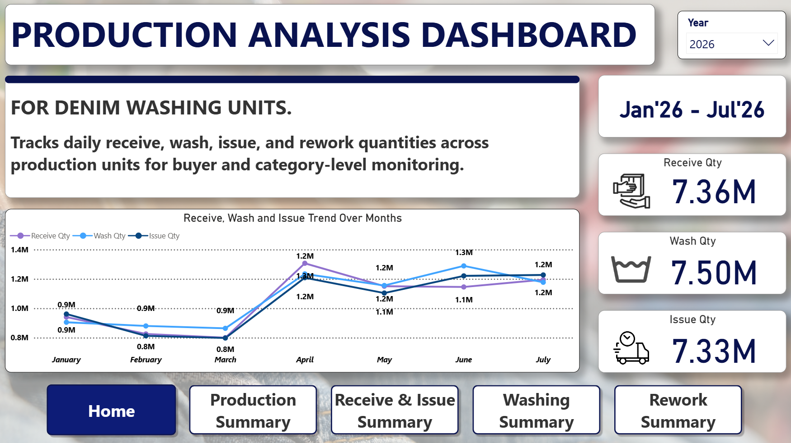
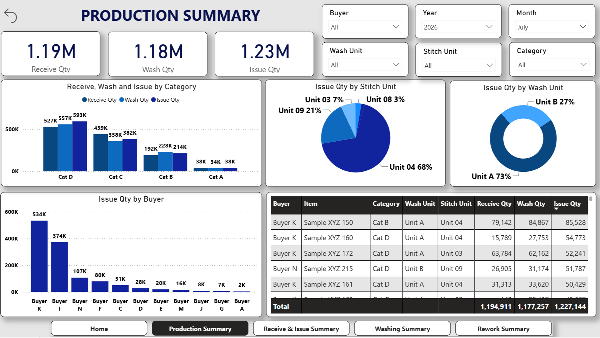
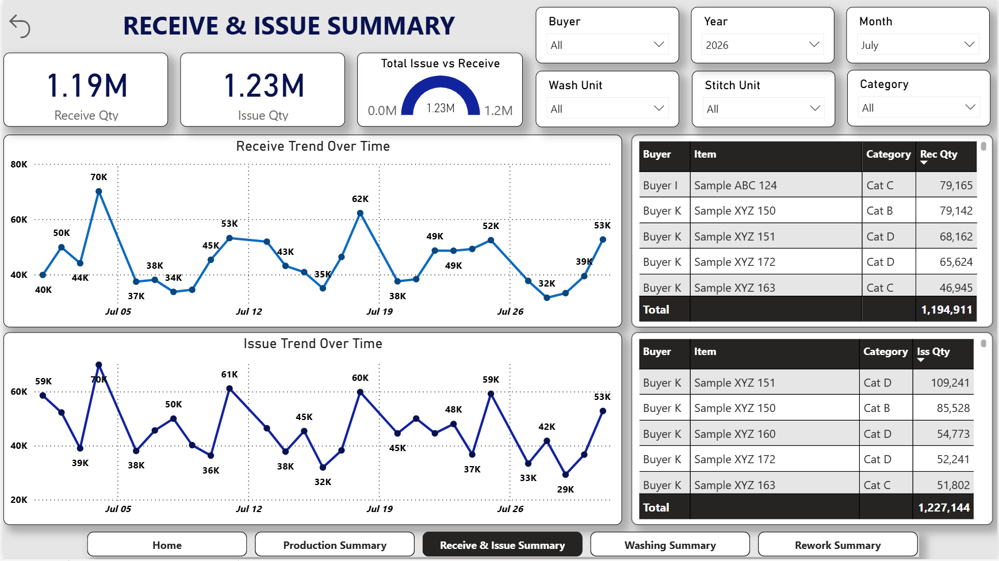
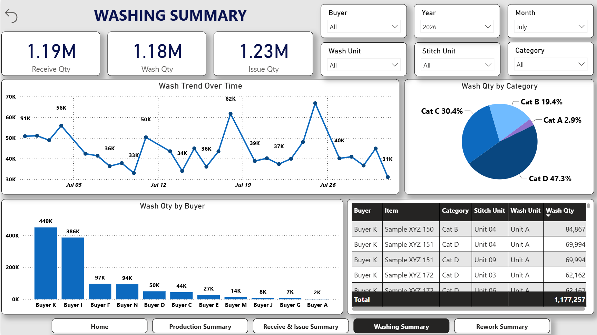
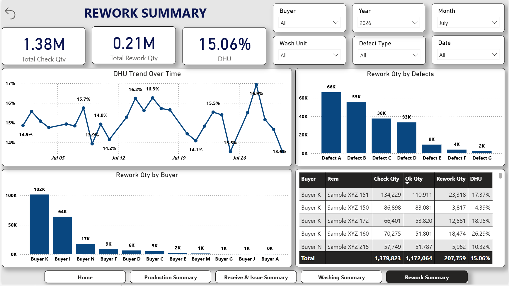

# Power-BI-Portfolio-01
# Production & Quality Control Dashboard — Power BI

A Power BI dashboard built for a garment manufacturing unit to track 
production and quality data across denim washing units. Data has been 
sanitized for confidentiality — all buyer names, item codes, and figures 
are sample values.

**Live dashboard:** [View interactive dashboard](https://app.powerbi.com/view?r=eyJrIjoiOTFlOTRmYWMtM2EyYi00OTI4LWI1OWQtMTM1ZDE1ODlhYjQ4IiwidCI6IjlhZmFmMWM0LTlhMzYtNDY3NS1hYTQ4LWQ2NmE4N2UxNTMxMyJ9)

---

## Overview
Tracks daily receive, wash, issue, and rework quantities across multiple 
production units, with buyer and category-level monitoring.

## Problem
Production data was scattered across separate Excel sheets (receive, wash, 
issue, rework), making quality issues hard to catch until after the fact. 
Management had no fast way to see which buyer, unit, or category was 
driving quality issues.

## What I built
- 5-page interactive dashboard: Home, Production Summary, Washing Summary, 
  Receive & Issue Summary, Rework Summary
- DAX measures for Receive/Wash/Issue quantities, DHU% (Defects per Hundred 
  Units), and rework breakdowns by defect type
- Power Query transformations merging multiple source tables into one 
  relational model
- Cross-page navigation with a unified filter panel (Buyer, Year, Month, 
  Unit, Category) for fast drill-down

## Result
- Daily reporting time cut from 2-3 hours to under 15 minutes
- Real-time visibility into DHU trend spikes as they happen
- Top defect categories surfaced clearly, enabling targeted quality action
- 4 disconnected data sources replaced with a single connected reporting tool

## Tools
Power BI · DAX · Power Query · Excel (data source)

## Screenshots

---

## Contact
Muhammad Atif Bashir — Data Analyst  
https://www.upwork.com/freelancers/~016235235021334af9?mp_source=share
